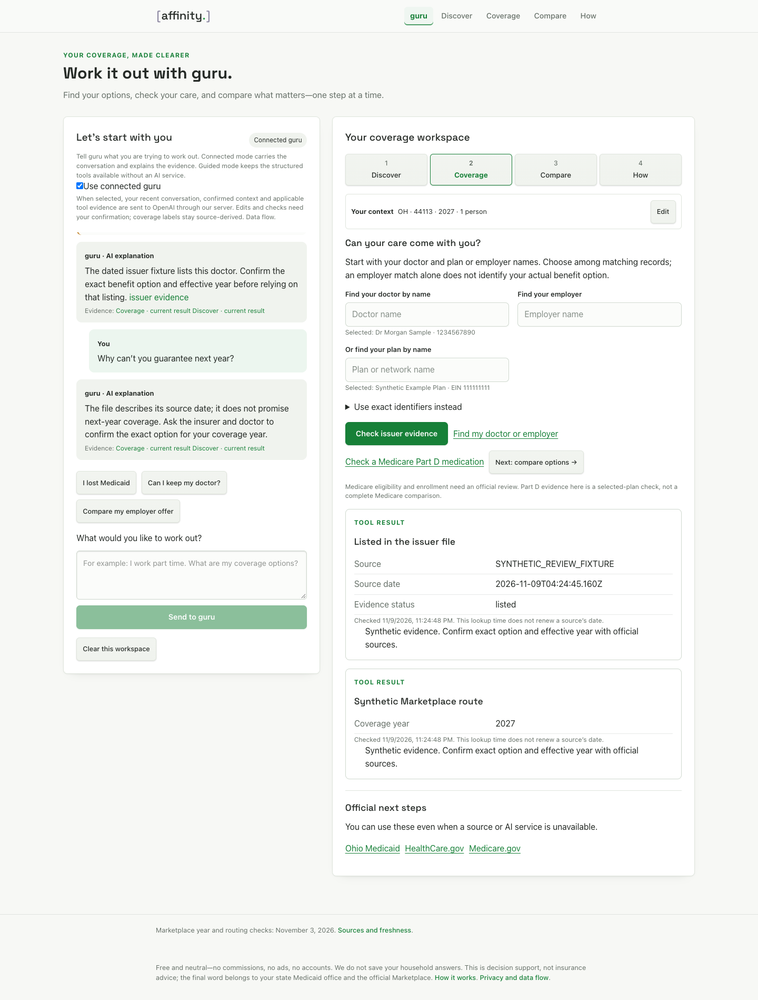
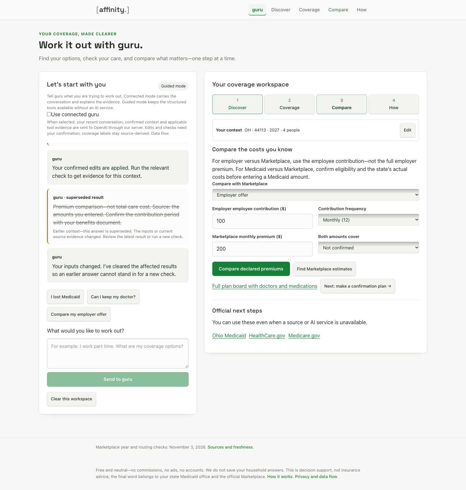

# Conversational guru review — November 9, 2026

The development slice now carries a coverage conversation through missing facts, confirmed context edits, confirmed tool actions, evidence explanations, follow-ups and corrections. The original guided router was insufficient for the operator’s requested [ribosome.]-like interaction. Its [dated prototype receipt](2026-11-09-guru-demo.md) remains historical; this report describes the subsequent implementation.

UI/source checkpoint: `b690d3e215a8230a9bef6d139d39b5a7212599e4`, branch `codex/guru-coverage-workspace`, [draft PR41](https://github.com/PWR-LABS/affinity/pull/41). The actual model repair protocol is separately pinned to `8ed7bf5549703f3950fc7627b11ab7cb128d138f`. Observations span November 9 Eastern / November 10 UTC on the Air and Mini. No merge, production migration, public AI activation, recurring allowance or application submission is established.

## Working interaction

The browser exercise uses the actual page, state, confirmation controls and application result handling, with mocked model/source HTTP responses. It makes nine synthetic conversational turns and no paid request. It demonstrates:

1. An initial question receives one missing-field question. Explicit facts become proposed edits; they do not replace context until confirmation.
2. A suggested coverage check runs only after the person confirms it. The resulting explanation carries current context, recent conversation and applicable evidence.
3. Doctor and plan/employer name searches expose matching records for selection. Users do not need to know NPI/EIN/HIOS identifiers. An employer match is not the exact benefit option.
4. A follow-up about next-year coverage uses the previous exchange and current evidence without asking for the whole story again. Source references render as readable links.
5. A household correction visibly supersedes affected chat claims and removes old cards. Changing source facts/status/date with the same inputs also supersedes old claims; retrieval time alone does not.
6. Every tested household write path resets the same-people premium basis, including conversational edits and the full comparison form. Conversation and selections survive site navigation in memory.

The following browser capture is **mocked conversation and synthetic evidence**, including its connected-mode label. Actual-model responses are recorded separately below.

## Original findings and repairs

| Finding | Current evidence and limit |
| --- | --- |
| F1 / GURU-CORR-02 — old chat claims remained active after a correction | Chat binds to request identity and a source-content fingerprint. Browser/unit checks cover input changes, same-input changed evidence, retrieval-only refresh and late returns. The actual source-correction case also moved from a prior positive to unknown. |
| F2 — employer offers caused a dead end | Unknown offers ask clarification; individual and household-member offers retain Medicaid and official affordability/minimum-value handoffs. Local subsidized estimates remain withheld. Browser and unit checks cover these branches. |
| F3 — household corrections could preserve an incompatible premium basis | The central context writer resets it through all tested write paths. Both amounts must be reconfirmed as covering the same people before comparison. |
| F4 — router-only interaction did not meet the requested conversation | History, the full accepted current user message, context and current evidence now reach the conversational adapter. Browser replay verifies a complete exchange. Human judgment of usefulness remains pending. |
| F5 — identity intake required technical identifiers | Existing name-based selectors now confirm doctor and plan/employer matches; new name queries invalidate old identifiers. Selection labels are keyed to the selected identity. |
| M1/M2 — actual model omitted explicit offer/name proposals and routed the doctor follow-up to Compare | The proposal contract was clarified. Both named real-model repair probes pass the original structured expectations and implementing-assistant review. This supports those specific repairs, not broad reliability. |
| M3 — actual model claimed a household edit was already applied | Original failure remains recorded. A regression replays its recognizable phrase into a narrow runtime guard; the prompt explicitly distinguishes pending proposals from completed edits. No third paid probe or complete semantic guarantee is claimed. |
| M4/M5 — reasked a confirmed frequency; asked ZIP before state | Prompt now prioritizes missing state and avoids repeating confirmed fields. These cases were not paid reruns; assess the remaining conversational behavior in the private walkthrough. |

## Actual model evidence and retained allowance

The [original eight-case conversation exercise](2026-11-09-guru-conversation-heldout.md) completed against protocol56e180a. Six passed structured checks; assistant review found additional workflow problems, including M3 despite its structured pass. Every response and finding is retained.

The [two named repair probes](2026-11-09-guru-conversation-repair.md) used the same frozen inputs after source8ed7bf5. The household offer is now proposed as `offered_household`, pending confirmation. The doctor follow-up now proposes its supplied search name and routes to Coverage. Neither invents an identifier or claims an edit already happened. Review was by the implementing assistant, not an independent blinded human.

All paid work shares the user’s original one-time **$5** maximum. The immutable 228-request baseline reserved $4.054254; eight conversation calls retained $0.40; two explicit repair probes retained $0.10. Total reservations are **$4.554254**, with **$0.445746** headroom and **eight interactive turns** remaining under the explicit allocation amendment. No reservation was refunded, no ledger reset and no automatic retry occurred. Conservative reported usage across all238 requests is **$0.299775**, not a provider invoice.

The extension journal preserves the original eight pairs of reservation/completion records, an append-only allocation amendment, and the two repair pairs. A shared lock, source/body/manifest hashes and reserve-before-dispatch apply to later review calls too. Source, parsed output, semantic review and human acceptance remain distinct.

## Verification and review surface

Air’s standard application suite passes **318/318**, without skipped tests. Standard TypeScript and the optimized Next build pass. The gateway test’s fixed-clock/pricing mismatch was repaired with a trusted test-clock injection; production pricing still uses real time and expires after the reviewed window. One incremental build hit a generated-cache hash failure; rebuilding the owned cache produced a successful optimized build.

Nine guru regression scenarios, the five-stage/nine-turn conversational browser exercise, and eight plan-year browser regressions pass. The latter retain Oregon2027 official routing, selected-year requests, stale/late result invalidation and mobile behavior. The browser checks include keyboard interaction and390px overflow; they are not screen-reader or comprehension studies. Temporary isolated Chrome contexts closed after use; no browser was installed or signed-in user profile used. Screenshot copies are byte-verified in the [manifest](assets/guru-demo/MANIFEST.md).

The original disposable PostgreSQL concurrency check remains in the prototype receipt; its task-created database was removed. The newer append-only evaluation ledger has filesystem concurrency, duplicate, uncertain-return and amendment tests. No production database/resource change was needed.

Mini checkpoint `85b7b288ec35febd6474c8e77b5d224202b8e35a` records its318/318 verification, actual repair results and prepared private review surface. Its loopback app, model gateway and review proxy respond; the disclosure page and fictional selectors were checked. Its browser exercise used mocked turns and consumed zero interactive reservations. The dedicated key stays on the Mini.

The connected review is intentionally retained at Mini-local `http://127.0.0.1:3013/review`. It uses real AI with disclosed fictional identity/source fixtures and unknown-only coverage evidence; only declared premium arithmetic is calculated. That address is local to the Mini. A connected route on another device has not been verified. The public site’s AI remains off, and the operator has not yet completed an interactive acceptance walkthrough.

The next action is the operator’s private conversational walkthrough, followed by any resulting repairs and the separate deployment/recurring-budget decision. Air chief owns the saved, unsubmitted HEBA application and will align its claims to the accepted result. No adoption, equity outcome, enrollment or application acceptance is inferred. Full Medicare comparison, voice and document-image extraction remain outside this slice.

Notion status: not applicable—technical implementation/evaluation, with the keeper product doctrine unchanged. SIDE working convention applied; the explicit SIDE caller was not invoked, so executable caller use and host enforcement are unassessed.
