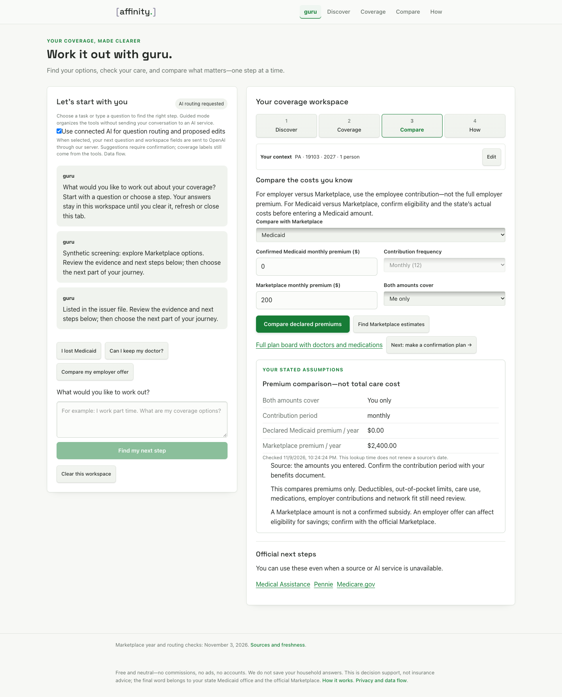
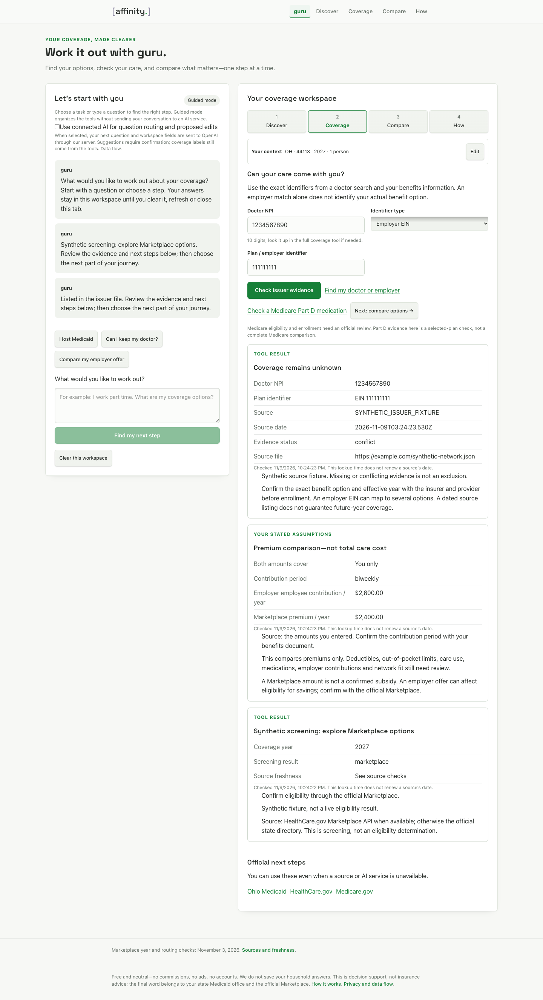
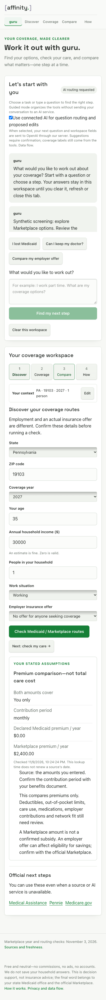

# guru workspace demo — November 9, 2026

**Historical guided/input-planner receipt.** This checkpoint did not meet the operator’s later clarified conversational completion bar. The original observations and limitations below are preserved; see the [subsequent conversational implementation and evidence](2026-11-09-guru-conversation-demo.md) for the current development slice.

Implementation checkpoint: `f95b29f7cf003fade7ba396f3cb22b25b48598ba`, branch `codex/guru-coverage-workspace`, [draft PR41](https://github.com/PWR-LABS/affinity/pull/41). Base `7e44893b575e5823d0e6b8f20e3f2ede798eac71`. Mini's original benchmark commits `2db4f8b` and `306d3c4` were inspected and cherry-picked as `a69d082` and `0fc1393`; its superseded navigation draft was excluded. The source is a working prototype for review, not a deployment receipt.

Observed on `nmai-macbook-air` during November 9 Eastern / November 10 UTC. Optimized production build, lint/type validation and standard TypeScript passed with a current-schema client generated into task-owned dependencies. The primary checkout's generated-client hash was unchanged. **All 299 application tests passed**, with no skipped tests. The primary checkout's divergent main and untracked Medicare document were not changed.

## Demonstrated journey

The production-mode loopback browser evaluator uses synthetic HTTP responses and mocked AI. It launches an isolated headless Chrome test context, without the user's signed-in profile, and closes it afterward. It performs no live model or source lookup. The page, form state, event handlers, fetch requests, response validation, correction guards and navigation are real application code at the implementation checkpoint.

| Step | Evidence and observed behavior |
| --- | --- |
| Discover | Working, age35, one-person household, declared income and state/ZIP. Unknown employer offer withholds the local subsidized estimate; explicit no relevant offer allows screening. A household-member offer is a separate value. Synthetic screening supplies an official confirmation next step. |
| Coverage | Exact NPI and EIN produce a synthetic dated issuer listing. NPI/plan mismatch is rejected. The source and internal update date remain distinct from the lookup time; an EIN is not certified as the person's exact benefit option. |
| Compare | $100 every two weeks becomes $2,600/year; $200/month becomes $2,400/year. Both must cover the same people. This is a premium comparison, with care costs still unknown. A separate Medicaid branch accepts an explicitly declared monthly amount, including zero, without assuming eligibility or free care. |
| How | A replayable three-step confirmation plan leads to maintained official Medicaid, Marketplace and Medicare destinations. The app never enrolls or cancels coverage. |
| Context | Household fields survive switching steps and navigating into the full Marketplace form. An edit there returns to guru; selected synthetic medication persists when returning to that form. No household context is put into URLs or persistent browser storage. |

The following capture shows the working comparison and handoff layout. Amounts are declared synthetic assumptions, not quotations or actual eligibility evidence. AI suggestions in this browser exercise are mocked.

## Missing evidence, corrections and fallback

The evaluator changes the issuer fixture to missing, stale and conflicting evidence. Each remains **Coverage remains unknown**, even if the response also carries a positive generic value. The source's own date controls the listing label. No majority vote or absence-as-exclusion is used. It then delays a provider response, changes the NPI, and releases the old response; the prior answer cannot return as current. A ZIP correction removes the affected screening/comparison evidence.

With a mocked AI proposal, Pennsylvania/19103 does not replace Ohio until the user confirms the edits. A subsequent 503 produces a guided fallback; comparisons and official handoffs remain usable. Model output cannot supply a coverage badge, source, price, eligibility decision or completed action because those fields are excluded from its strict schema. Unit tests reject such fields, unreviewed models, oversized requests, stale pricing and malformed/incomplete returns. Prompt-injection text is serialized as user data, with no model tools or publication permissions.

This is a bounded input-planning design, not a general free-form insurance counselor. The model currently proposes navigation and context; evidence summaries remain application-generated. The real conversational integration claim requires a separately authorized exercise of the exact adapter, review of the results and the operator's walkthrough. The existing three-model benchmark did not exercise this adapter or execute tools.

## Accessibility and regression checks

Keyboard Tab/Space activates the journey controls. The split panel stacks at 390px with no horizontal overflow and retains context. The evidence region receives focus after a completed check. These are browser checks and visual inspection, not a screen-reader or comprehension study.

The existing plan-year browser evaluator was adapted to the new `/discover` location and explicit employer-offer question. All eight checks passed against the optimized build: Oregon2027 official handoff, year-preserving navigation, provider-search year, clearing old selections, late result suppression, mismatched-year rejection, mobile overflow and real-clock source-status display.

## Durable allowance gate

`eval-guru-budget.ts` ran against a new disposable loopback PostgreSQL database named `affinity_guru_e2e_202611100310`. It created only its fresh reservation table and exercised two independent clients. Eight concurrent requests under a $0.10 cap admitted exactly two $0.05 reservations. Duplicate UUIDs were rejected. Reservations survived disconnect/reconnect. A simulated lost provider response retained its reservation and dispatched exactly once. **Zero model calls** were made. This establishes the tested local transaction behavior, not production migration, resource headroom, provider invoices or public-user acceptance.

Connected AI defaults off. Public recurring caps and deployment remain unapproved, and the new migration has not been applied to production. The exact activation contract is in [GURU_WORKSPACE.md](../GURU_WORKSPACE.md).

## Evidence distinctions and remaining work

- **Implemented:** guided guru-first workspace; shared context; deterministic evidence/cost handling; optional strict input planner; durable aggregate reservation code; privacy disclosure.
- **Tested locally:** 299 tests, typecheck, optimized build, nine guru browser checks, eight year-regression browser checks and the disposable two-client PostgreSQL gate. Browser screenshots are copied unchanged; [manifest](assets/guru-demo/MANIFEST.md).
- **Actual model evidence:** Mini's separately recorded [228-request baseline](2026-11-09-guru-model-benchmark.md), with Terra as next integration candidate. This is not an actual guru UI integration exercise or independent blinded human review.
- **Still open:** exact-adapter real-model exercise and any necessary aggregate-budget extension decision; critique of conversational usefulness; operator walkthrough; public recurring allowance; migration/deployment review and hosted readback. Complete Medicare comparison, voice and document-image extraction were not implemented.
- **Application:** Air chief owns the saved, unsubmitted HEBA application and will align claims to returned evidence. No adoption, equity outcome, institutional customer or application acceptance is established here.
- **Notion:** not applicable; technical implementation/evaluation only, keeper doctrine unchanged.

Reproduce with Node24.22.1 using the ordinary tests/build and the two evaluator commands in the workspace runbook. Logs and generated local test dependencies remain ignored under `tmp/`; the public report contains only synthetic artifacts. The local preview is an intentional review surface, not a production deployment.
